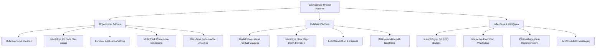
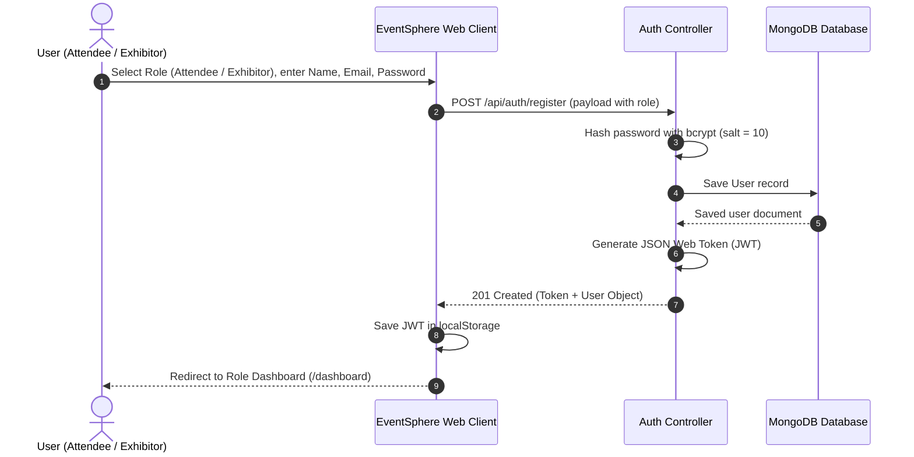
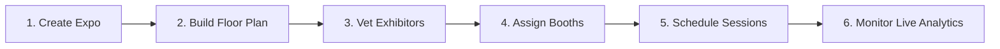
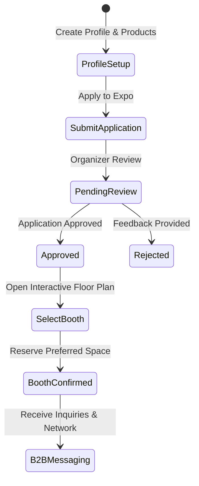

# EventSphere — Comprehensive User Documentation & Operations Guide
> **Version:** 2.5 • **Audience:** Event Organizers, Exhibiting Partners & Expo Attendees • **Platform:** EventSphere Enterprise Cloud

---

## Table of Contents
1. [Executive Overview & Background](#1-executive-overview--background)
2. [Platform Roles & Access Model](#2-platform-roles--access-model)
3. [User Authentication & Security Guide](#3-user-authentication--security-guide)
4. [Organizer / Admin Master Guide](#4-organizer--admin-master-guide)
   - [4.1 Expo Portfolio Management](#41-expo-portfolio-management)
   - [4.2 Interactive 2D Floor Plan Studio](#42-interactive-2d-floor-plan-studio)
   - [4.3 Exhibitor Application & Vetting Lifecycle](#43-exhibitor-application--vetting-lifecycle)
   - [4.4 Multi-Track Conference & Keynote Scheduler](#44-multi-track-conference--keynote-scheduler)
   - [4.5 Real-Time Telemetry, Analytics & Reporting](#45-real-time-telemetry-analytics--reporting)
5. [Exhibitor Partner Portal Guide](#5-exhibitor-partner-portal-guide)
   - [5.1 Profile Setup & Digital Showcase](#51-profile-setup--digital-showcase)
   - [5.2 Applying to Expos & Tracking Approvals](#52-applying-to-expos--tracking-approvals)
   - [5.3 Interactive Booth Selection & Reservation](#53-interactive-booth-selection--reservation)
   - [5.4 B2B Direct Messaging & Networking](#54-b2b-direct-messaging--networking)
6. [Attendee Experience Guide](#6-attendee-experience-guide)
   - [6.1 Discovering Events & Instant Digital QR Passes](#61-discovering-events--instant-digital-qr-passes)
   - [6.2 Exhibitor Directory & Booth Floor Locator](#62-exhibitor-directory--booth-floor-locator)
   - [6.3 Personal Agenda Builder & Session Reminders](#63-personal-agenda-builder--session-reminders)
   - [6.4 Inquiries & Direct Appointments](#64-inquiries--direct-appointments)
7. [Step-by-Step Interactive Tutorials](#7-step-by-step-interactive-tutorials)
8. [Frequently Asked Questions (FAQ)](#8-frequently-asked-questions-faq)
9. [Feedback, Support & Helpdesk](#9-feedback-support--helpdesk)

---

## 1. Executive Overview & Background

### 1.1 The Challenge of Traditional Expo Operations
Traditional exhibition and trade show management has long suffered from fragmented operational silos:
- **Manual, paper-based floor plans:** Booth allocation often relied on physical drawings, resulting in double bookings, communication breakdowns, and delayed sponsor confirmations.
- **Disconnected Registration:** Organizers struggled to reconcile attendee entry badges, exhibitor credentials, and VIP lists across disparate software tools.
- **Lagging Communications:** Attendees lacked live schedule updates, leading to overcrowded auditoriums or missed keynote addresses.
- **Zero Real-Time Visibility:** Sponsors and exhibitors had minimal insight into foot traffic, session popularity, or return on event investment (ROI).

### 1.2 The EventSphere Solution
**EventSphere Management** created this all-in-one digital operating system to unite **Organizers**, **Exhibiting Companies**, and **Attendees** into a single, cohesive, real-time ecosystem.



---

## 2. Platform Roles & Access Model

EventSphere implements strict Role-Based Access Control (RBAC). Upon registration or login, users are routed to their role-specific portal:

| Role | Target Persona | Primary Responsibilities & Permissions |
| :--- | :--- | :--- |
| **Admin / Organizer** | Event Directors, Floor Managers, Conference Chairs | Full control over expo portfolios, floor plans, booth assignments, schedule builders, application approvals, and global analytics. |
| **Exhibitor** | Sponsoring Companies, Hardware/Software Vendors, Startups | Manage digital company profile, apply to upcoming trade shows, select booths on 2D floor plans, interact with attendees and neighboring exhibitors. |
| **Attendee** | Delegates, Industry Professionals, Buyers, Students | Discover exhibitions, register for free or VIP passes, print digital QR badges, bookmark speaker sessions, and chat with exhibiting companies. |

> [!NOTE]
> EventSphere features a unified global navigation and a **Command Palette (`Ctrl+K` or `⌘K`)** allowing instant search and navigation across all modules, events, and features.

---

## 3. User Authentication & Security Guide

### 3.1 Creating an Account
1. Navigate to the top-right of the homepage and click **Sign Up** (or visit `/register`).
2. Select your account type:
   - **Attendee Card**: For visiting exhibitions, discovering products, and attending sessions.
   - **Exhibitor Partner Card**: For companies looking to book booths and showcase innovations.
3. Enter your **Full Name**, **Business Email**, and secure **Password** (minimum 6 characters).
4. Review terms and click **Create Account**. You will immediately be authenticated and directed to your personalized dashboard.



### 3.2 Sign In & Quick Demo Mode
1. Visit `/login`.
2. Enter your credentials and click **Sign In**.
3. **Demo Quick-Fill Pills**: If testing the application, click any of the 1-click test buttons to instantly populate verified demo credentials:
   - `Organizer`: `admin@eventsphere.com`
   - `Exhibitor`: `exhibitor@techcorp.com`
   - `Attendee`: `attendee@eventsphere.com`

### 3.3 Password Reset Workflow
If you forget your password:
1. Click **Forgot password?** on the sign-in card (or visit `/forgot-password`).
2. Enter your registered email address and submit.
3. A secure, time-limited reset token is generated. On development systems, a direct one-click **"Reset Password Now"** button and simulated email delivery preview link are displayed on the confirmation screen for immediate access.
4. Set your new password and log in securely.

> [!IMPORTANT]
> All passwords are cryptographically salted and hashed using `bcrypt` prior to storage. Plaintext passwords are never logged, stored, or transmitted.

---

## 4. Organizer / Admin Master Guide

The **Organizer Dashboard** (`/admin/dashboard`) provides end-to-end command of the expo lifecycle:



### 4.1 Expo Portfolio Management
- **View All Events (`/admin/expos`):** Displays all ongoing, published, and draft expos in a clean tabular layout with search and status filtering.
- **Create New Expo (`/admin/expos/create`):**
  - **Event Title & Theme:** Enter official title (e.g., *Global Tech & AI Summit 2026*) and industry theme.
  - **Dates & Venue:** Set start date, end date, and physical venue address.
  - **Grid Synthesis:** Define initial booth layout dimensions (`Booth Rows` × `Booth Columns`). The system automatically creates every individual booth unit with smart naming (`A-1`, `A-2`, `B-1`, etc.).
  - **Banner Imagery:** Provide high-resolution banner URL for the public catalog.
- **Editing Expos (`/admin/expos/:id/edit`):** Update dates, location, descriptions, and publication status in real time.

### 4.2 Interactive 2D Floor Plan Studio
Accessible via `/admin/expos/:id/floor-plan`:

1. **Visual Map Canvas:**
   - Displays all synthesized booth spaces organized by aisles (`A`, `B`, `C`, etc.).
   - Landmark waypoints indicate **Main Hall Entrance**, **Keynote Auditorium**, and **VIP Networking Lounge**.
   - Color codes:
     - 🟢 **Emerald:** Available for booking.
     - 🟡 **Amber:** Reserved / pending confirmation.
     - 🔵 **Blue:** Occupied by an approved exhibitor company.
2. **Interactive Controls:**
   - **Search Booth:** Real-time filter by booth number (`A-3`) or exhibiting company name.
   - **Zoom In / Out (`75%` to `140%`):** Effortlessly inspect large exhibition halls.
3. **Booth Configuration Modal:**
   - Click any booth tile on the map to open the configuration dialog.
   - **Size Tier Selection:** Choose from *Small (3×3m Standard)*, *Medium (6×3m Premium)*, or *Large (9×6m Island Pavilion)*.
   - **Rate Configuration:** Update booth price in USD.
   - **Location Notes:** Document amenities (e.g., *10Gbps dedicated fiber, corner entrance*).
   - **Exhibitor Allocation:**
     - Search from verified platform exhibitors or approved applicants.
     - Select from 1-click **Quick Pick Company Cards**.
     - Review company preview (contact person, email, category) and click **Assign Booth**.
     - For occupied booths, use **Reassign Company** or **Release Booth to Open Pool**.

### 4.3 Exhibitor Application & Vetting Lifecycle
Accessible via `/admin/expos/:id/exhibitors` or `/admin/exhibitors`:
1. View incoming partner applications with company profiles, product catalogs, contact credentials, and submission timestamps.
2. Use filter pills to isolate `Pending`, `Approved`, or `Rejected` applications.
3. **One-Click Actions:**
   - **Approve:** Grants the company immediate booth reservation privileges and triggers automated notifications.
   - **Reject:** Declines the application with optional notes.

### 4.4 Multi-Track Conference & Keynote Scheduler
Accessible via `/admin/expos/:id/schedule`:
1. **Schedule New Session:**
   - Session Title, Topic Track (*AI & Robotics*, *Clean Energy*, *FinTech*, *Keynote*).
   - Speaker Name, Professional Title, and Speaker Bio.
   - Room / Stage Location (e.g., *Grand Keynote Auditorium A*).
   - Start Time, End Time, and Maximum Seat Capacity.
2. **Live Occupancy Tracking:** Visual progress bars show real-time seat bookings vs. room capacity, preventing fire code overbooking.

### 4.5 Real-Time Telemetry, Analytics & Reporting
Accessible via `/admin/analytics/:id`:
- **Executive KPI Cards:** Total Registrations, Revenue Generated, Booth Occupancy %, and Sessions Booked.
- **Engagement Trajectory:** Daily registration trends visual bar chart.
- **Booth Traffic & Revenue Breakdown:** Size tier demand and revenue contribution.
- **Session Popularity Leaderboard:** Top-attended talks ranked by delegate reservations.
- **Exporting Data:** One-click CSV and printable summary reports for stakeholders.

---

## 5. Exhibitor Partner Portal Guide

The **Exhibitor Portal** (`/exhibitor/dashboard`) empowers partner companies to maximize their trade show ROI:



### 5.1 Profile Setup & Digital Showcase
1. Navigate to **Company Profile** (`/exhibitor/profile`).
2. Populate organizational details:
   - **Company Name**, **Website**, and **Corporate Bio**.
   - **Contact Person**, **Official Email**, and **Phone Number**.
   - **Flagship Products & Services:** Tag core offerings (e.g., *LiDAR Sensors, Neural Computing*).
   - **Company Logo:** Upload or link corporate badge for public directory listings.

### 5.2 Applying to Expos & Tracking Approvals
1. Browse upcoming trade shows at `/expos`.
2. Click **Apply to Exhibit** on your chosen event.
3. Review your auto-populated profile information, add custom event booth requests, and submit.
4. Track status in real time on **My Applications** (`/exhibitor/applications`). Statuses update automatically from `Pending` to `Approved` or `Rejected`.

### 5.3 Interactive Booth Selection & Reservation
Once your application is approved:
1. Click **Select Booth** on your application card, or visit `/exhibitor/booth/:expoId`.
2. Review the interactive 2D floor plan:
   - Green tiles indicate available booths.
   - Hover over booths to see dimensions (e.g., *6×3m Medium*), price, and location amenities (*near main stage*).
3. Click your preferred available booth to inspect full specifications.
4. Click **Confirm Reservation**. The booth is instantly allocated to your organization, marked as *Occupied* on the master map, and added to your event pass.

### 5.4 B2B Direct Messaging & Networking
1. Visit the **Messages** tab (`/messages`).
2. Attendees and organizers can initiate direct chats regarding product demonstrations, partnership meetings, or logistical questions.
3. Exhibitors can also reach out to neighboring booth partners to coordinate floor promotions and cross-company demos.

---

## 6. Attendee Experience Guide

The **Attendee Portal** (`/attendee/dashboard`) offers an effortless visit experience from discovery to on-site check-in:

### 6.1 Discovering Events & Instant Digital QR Passes
1. Browse the global expo catalog at `/expos` with keyword search and industry filters (*Artificial Intelligence*, *Healthcare*, *Clean Energy*, *FinTech*).
2. Click into any event to view date, venue, speaker lineup, and exhibiting brands.
3. Click **Register for Event**:
   - Registration confirms immediately.
   - A verified digital pass with a unique QR check-in code is generated.
   - Click **Print Ticket / Badge** to generate an official on-site badge format with your name, event details, and entry barcode.

### 6.2 Exhibitor Directory & Booth Floor Locator
On the event detail page (`/expos/:id`), click the **Exhibitors** tab:
1. **Search & Filter:** Search by company name, technology keywords, or filter by industry category.
2. **Interactive Booth Wayfinding:** Click **"Locate on Floor Map"** on any company card; the system automatically switches to the Floor Plan tab, centers the map, and highlights the company's assigned booth tile.
3. **Company Deep-Dive:** Click **"View Showcase"** to read detailed product descriptions, services, website links, and team contacts.

### 6.3 Personal Agenda Builder & Session Reminders
1. Under the **Schedule** tab on any event page, browse multi-track sessions.
2. Click **"Save Session"** to bookmark keynotes, panel discussions, or technical workshops.
3. Navigate to **My Schedule** (`/attendee/schedule`):
   - Review your chronological agenda across all registered events.
   - **Lead Time Setting:** Configure reminder alerts (*15m*, *30m*, or *1h* before start).
   - **Test Reminders:** Click **Test Reminder Notification** to verify real-time browser alerts.
   - **Print Agenda:** Export your customized conference timetable for off-line reference.

### 6.4 Inquiries & Direct Appointments
1. Click **"Send Message / Inquiry"** on any exhibitor profile.
2. Choose between:
   - **General Product Inquiry:** Ask technical questions or request collateral.
   - **Booth Appointment:** Select a proposed time slot (e.g., *Day 1 — 10:30 AM*) to meet booth staff on-site.

---

## 7. Step-by-Step Interactive Tutorials

### Tutorial 1: Organizer — Launch an Expo & Assign Booths in 5 Minutes
```mermaid
sequenceDiagram
    autonumber
    actor Admin as Event Organizer
    participant Dashboard as Admin Dashboard
    participant Create as Create Expo Wizard
    participant Floor as 2D Floor Plan Studio

    Admin->>Dashboard: Click "+ Create Event"
    Dashboard->>Create: Load Wizard Form
    Admin->>Create: Input Title, Location, Dates, Rows (4) & Cols (6)
    Create->>Create: Synthesize 24 Booth Units (A-1 to D-6)
    Create-->>Dashboard: Event Published Successfully!
    Admin->>Floor: Open /admin/expos/:id/floor-plan
    Admin->>Floor: Click Booth "A-1" (Available)
    Admin->>Floor: Select "TechCorp Autonomous Systems" from Quick Pick
    Admin->>Floor: Click "Assign Booth"
    Floor-->>Admin: Booth A-1 turns Blue (Occupied by TechCorp)
```

1. Log in as an Organizer (`admin@eventsphere.com`).
2. Click **Create Event** on your dashboard.
3. Fill in the event title, venue, and select `4` rows and `6` columns (24 booth spaces).
4. Click **Launch Event**. The system synthesizes the entire hall.
5. In the events table, click the **Booths** button next to your new event.
6. Click any green booth tile (e.g. `A-1`). In the modal, pick **TechCorp Autonomous Systems** and click **Assign Booth**. The tile turns blue and displays the company name.

---

### Tutorial 2: Exhibitor — Profile, Application & Booth Selection
1. Log in as an Exhibitor (`exhibitor@techcorp.com`).
2. Go to **Company Profile** and ensure your flagship products and services are listed.
3. Go to **Browse Events**, choose *Global Tech & AI Summit 2026*, and click **Apply to Exhibit**.
4. Once the organizer approves, visit **My Applications** and click **Select Booth**.
5. Browse the map, pick an open booth near the Keynote Stage (e.g. `A-3`), and click **Confirm Reservation**.
6. Your booth number is now locked and visible across the entire platform.

---

### Tutorial 3: Attendee — Registration, Session Bookmarking & Pass Printing
1. Log in as an Attendee (`attendee@eventsphere.com`).
2. Open *Global Tech & AI Summit 2026* from the public catalog.
3. Click **Register for Event**. Your pass is confirmed instantly.
4. Switch to the **Schedule** tab, find *"Keynote: The Future of Bipedal Humanoid Robotics"*, and click **Save Session**.
5. Open **My Schedule** (`/attendee/schedule`) to verify the talk is scheduled and notification reminders are armed.
6. Open your dashboard and click **Print Badge** to view your printable QR event credential.

---

## 8. Frequently Asked Questions (FAQ)

### General Platform Questions
<details>
<summary><strong>Q: What browsers and devices does EventSphere support?</strong></summary>
EventSphere is fully responsive and optimized for modern web browsers including Google Chrome, Mozilla Firefox, Apple Safari, and Microsoft Edge. It supports mobile viewports, tablets, and 4K desktop displays.
</details>

<details>
<summary><strong>Q: Is EventSphere real-time?</strong></summary>
Yes. EventSphere uses a high-performance WebSocket architecture (Socket.io). When a booth is booked, a session schedule is adjusted, or a new message arrives, connected clients receive immediate updates without needing manual page refreshes.
</details>

<details>
<summary><strong>Q: How does the global search work?</strong></summary>
Press <code>Ctrl+K</code> (Windows/Linux) or <code>⌘K</code> (macOS) anywhere in the application to open the Command Palette. You can jump directly to any page, event, booth, or profile in milliseconds.
</details>

### Organizer FAQs
<details>
<summary><strong>Q: Can I change booth dimensions and prices after publishing an event?</strong></summary>
Yes. Open the 2D Floor Plan Studio, click any booth tile, update its size tier (Small/Medium/Large) and rate, and click "Save Booth Specs". All updates reflect immediately.
</details>

<details>
<summary><strong>Q: What happens when an exhibitor application is rejected?</strong></summary>
The exhibitor's status changes to "Rejected" with the feedback provided. They cannot book floor space for that specific event unless re-approved by an organizer.
</details>

<details>
<summary><strong>Q: How do session room capacities work?</strong></summary>
Organizers set a maximum seat capacity for each keynote or workshop. The system tracks attendee bookings and prevents overbooking when the capacity reaches 100%.
</details>

### Exhibitor FAQs
<details>
<summary><strong>Q: Can my company change its assigned booth?</strong></summary>
If you wish to switch booths, contact the organizer via the Messages tab or request a booth release. Once released, you can select any other available booth on the floor plan.
</details>

<details>
<summary><strong>Q: Where do attendee inquiries appear?</strong></summary>
Inquiries sent by attendees through your company showcase appear in real time on your Messages page (`/messages`), clearly flagged with the sender's details and event context.
</details>

### Attendee FAQs
<details>
<summary><strong>Q: Do I need a physical ticket to enter the exhibition hall?</strong></summary>
No. You can display your digital QR code from your phone via the Attendee Dashboard, or click "Print Badge" to bring a paper copy for badge scanners at the registration desk.
</details>

<details>
<summary><strong>Q: How do session reminders notify me?</strong></summary>
When active, EventSphere surfaces in-app toast alerts at your designated lead time (15m, 30m, 1h) before the speaker starts.
</details>

---

## 9. Feedback, Support & Helpdesk

We continuously refine EventSphere based on user suggestions:
- **Event Feedback:** At the bottom of any event page, use the **Feedback & Reviews** widget to submit a 1 to 5-star rating and qualitative feedback.
- **Organizer Contact:** Message event organizers directly via the **Messages** module.
- **System Inquiries:** Reach the EventSphere Enterprise support desk at `support@eventsphere.example.com`.
