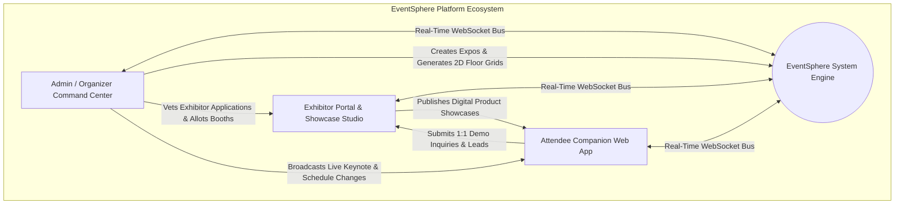

# EventSphere Management System — User Documentation & Operations Manual
**Version:** 2.4.0 Enterprise Edition  
**Platform:** EventSphere Management Suite  
**Author:** EventSphere Product Management & Solutions Architecture Team  
**Confidentiality:** Enterprise Confidential  
**Direct Word Document Download:** [EventSphere_User_Documentation.docx](file:///c:/Users/dell/Desktop/EventSphere/docs/EventSphere_User_Documentation.docx)  

---

## Executive Table of Contents
1. [Chapter 1: Executive Background, Problem Statement & Strategic Vision](#chapter-1-executive-background-problem-statement--strategic-vision)
2. [Chapter 2: User Authentication & Role Architecture](#chapter-2-user-authentication--role-architecture)
3. [Chapter 3: Admin & Organizer Command Center Master Guide](#chapter-3-admin--organizer-command-center-master-guide)
4. [Chapter 4: Exhibitor Portal & Digital Showcase Studio](#chapter-4-exhibitor-portal--digital-showcase-studio)
5. [Chapter 5: Attendee Interactive Companion Interface](#chapter-5-attendee-interactive-companion-interface)
6. [Chapter 6: General Platform Features & Real-Time Sync](#chapter-6-general-platform-features--real-time-sync)
7. [Chapter 7: Non-Functional Guarantees from a User Perspective](#chapter-7-non-functional-guarantees-from-a-user-perspective)
8. [Chapter 8: Hands-On Operational Step-by-Step Tutorials](#chapter-8-hands-on-operational-step-by-step-tutorials)
9. [Chapter 9: Frequently Asked Questions & Troubleshooting](#chapter-9-frequently-asked-questions--troubleshooting)

---

## Chapter 1: Executive Background, Problem Statement & Strategic Vision

### 1.1 Corporate Background
EventSphere Management is a premier international event management enterprise recognized across North America, Europe, and Asia-Pacific for organizing mega-scale trade exhibitions, industrial conventions, and technological summits. With an annual portfolio exceeding 150 international expos and accommodating over 500,000 corporate delegates and 12,000 exhibiting corporations, EventSphere recognized early that traditional event workflows had reached operational exhaustion.

### 1.2 The Traditional Expo Management Dilemma
Traditional expo operations suffer from critical friction points:
- **Manual Registration Bottlenecks:** Paper forms and static spreadsheets lead to data reconciliation errors and hours-long on-site registration lines.
- **Rigid & Static Floor Planning:** Static PDF floor plans require manual drafting in CAD. A single booth change frequently causes double-booking errors and misallocated square footage.
- **Disjointed Communications:** Unmonitored email threads and paper flyers result in lost electrical permits, booth reassignments, and emergency notices.
- **Information Asymmetry for Attendees:** Attendees navigate 200,000 sq ft convention centers with crumpled paper maps, missing relevant exhibitors and keynotes.
- **Zero Real-Time Intelligence:** Organizers lack real-time visibility into hall occupancy, session attendance, and booth foot traffic.

### 1.3 The EventSphere Digital Platform Solution
EventSphere bridges the divide between Organizers, Exhibitors, and Attendees within a single unified web platform with sub-second real-time synchronization.

---

## Chapter 2: User Authentication & Role Architecture

### 2.1 Role-Based Access Control (RBAC) Architecture
EventSphere provides granular access boundaries for three distinct system roles:
- **Admin / Organizer:** Full governance over expos, floor layout synthesis, exhibitor vetting, schedule building, and revenue/traffic analytics.
- **Commercial Exhibitor:** Profile storefront management, compliance documentation submission, 2D floor browsing, real-time booth reservation, product catalog showcasing, and B2B lead capture.
- **Registered Attendee:** Expo discovery, digital QR badge generation, multi-filter exhibitor search, interactive booth locator, and personalized timetable bookmarking.

### 2.2 Role & Privilege Matrix
| Platform Module / Action | Organizer / Admin | Commercial Exhibitor | Trade Attendee |
| :--- | :--- | :--- | :--- |
| **Expo Creation, Editing & Deletion** | Full Access (Create / Edit / Delete) | No Access | No Access |
| **Floor Plan Synthesis & Grid Config** | Full Access (Generate / Modify) | View Only (Active Floor) | View Only (Interactive Map) |
| **Exhibitor Application Vetting** | Full Access (Approve / Reject) | Self Application Only | No Access |
| **Direct Booth Space Assignment** | Full Access (Any Booth / Company) | Self-Reservation Request | No Access |
| **Product / Service Showcase Studio** | Audit & Moderation | Full Access (Create / Edit) | View & Inquiry Only |
| **Master Schedule & Speaker Setup** | Full Access (Add / Edit / Reschedule) | View & Session Register | View & Session Register |
| **Personal Timetable & Bookmarks** | Available | Available | Full Access (Personal Sync) |
| **B2B Inquiries & Direct Messaging** | Broadcast & Direct Chat | Bi-directional Inquiries | Inquiry Submission |
| **Real-Time Analytics & Reports** | Full Access (Export CSV/PDF) | Booth Traffic Metrics | No Access |

### 2.3 Password Security & Self-Service Recovery
- **Encryption:** Passwords hashed with bcrypt (salt factor 10). Plaintext secrets are never stored.
- **Recovery Workflow:** Users initiate self-service reset via email. High-entropy 32-byte cryptographic tokens with 60-minute expiration ensure bank-grade security.

---

## Chapter 3: Admin & Organizer Command Center Master Guide

### 3.1 Macro Operational Pipeline
1. **Create Expo Event:** Define Title (e.g. *Global FinTech & Digital Banking Forum 2026*), venue, operating hours, category, and visual branding banner.
2. **Synthesize 2D Floor Plan:** Algorithmic grid generator computes rows, columns, walkway aisles, registration desks, emergency exits, and keynote stages.
3. **Configure Booth Sizing Tiers:**
   - *Standard In-Line (10x10 ft):* $1,800 - $2,500 base price. Includes 500W power, Wi-Fi.
   - *Premium Corner (20x20 ft):* $4,500 - $6,000 base price. Includes 2 kW power, 2 open aisles.
   - *Island Pavilion (30x30 ft):* $12,000 - $18,000 base price. 4-way aisle exposure, 10 kW 3-phase power.
4. **Vet Commercial Exhibitors:** Review submitted business licenses, electrical hookup manifests, and booth choices. One-click Approve or Reject.
5. **Master Schedule & Keynote Sessions:** Add presentation tracks, speaker bios, auditorium venues, and seat capacity limits.
6. **Live Analytics & Intelligence:** Real-time dashboards monitoring attendee check-in pacing, booth foot-traffic heatmaps, session popularity rankings, and revenue collections.

---

## Chapter 4: Exhibitor Portal & Digital Showcase Studio

### 4.1 Enterprise Profile & Compliance Setup
- Input registered corporate name, industry focus, contact leads, and official website.
- Upload high-resolution corporate logo and booth branding banners.
- Specify utility requirements: 110V/220V power drops, hardwire Gigabit Ethernet, plumbing.
- Register booth staff roster for automatic issuance of on-site credentials.

### 4.2 Interactive Booth Selection
- Pan and zoom across the live 2D floor plan.
- Real-time reservation lock: 15-minute hold prevents race conditions.
- Direct submission into the organizer vetting queue.

### 4.3 Digital Product Catalog
- List flagship hardware, software, and enterprise consulting offerings.
- Attach downloadable PDF brochures, technical specifications, and case studies.

### 4.4 B2B Inquiries & Collaboration
- **Attendee Inquiries:** Instant chat notifications for meeting requests and product demos.
- **Neighboring Exhibitor Network:** Direct communication with adjacent booths along the same aisle to coordinate logistics and co-marketing.

---

## Chapter 5: Attendee Interactive Companion Interface

### 5.1 Discovery & Digital QR Pass
- Browse upcoming expos, keynote speakers, and participating corporate brands.
- Instant registration generates a secure digital pass with dynamic 2D QR code and anti-counterfeit SHA-256 verification hash.

### 5.2 Intelligent Search & Floor Map Pinpointing
- Filter exhibitors by vertical (FinTech, AI, CyberSecurity), product keyword, or hall wing.
- **"Locate on Map":** Instantly navigates to the 2D floor plan, highlighting the selected exhibitor's booth with a glowing cyan pin.

### 5.3 Schedule Management & Personal Timetable
- Multi-track timeline view of all keynotes, panels, and workshops.
- One-click bookmarking to personal timetable.
- Automated push notifications dispatched 15 minutes before bookmarked sessions begin.

---

## Chapter 6: General Platform Features
- **Real-Time WebSocket Sync:** Powered by Socket.io. State updates (booth booking, schedule change, chat) render in sub-100ms without page refresh.
- **Support & Feedback Desk:** Integrated ticket modal for urgent facility assistance, electrical repairs, and bug reports.

---

## Chapter 7: Hands-On Step-by-Step Tutorials

### Tutorial 1: Organizer Expo Launch Walkthrough
1. Log into Organizer Command Center.
2. Click **Create New Expo** -> Enter *"Global FinTech & Digital Banking Forum 2026"*, Hall 4, Nov 14-17, 2026.
3. Open **Floor Plan Designer** -> Set 100 booths (5 rows x 20 cols, 12 ft aisles). Click **Generate Grid**.
4. Designate corner booths as Premium ($5,000) and perimeter as Standard ($2,000). Place Main Stage and Registration landmarks.
5. In **Schedule Manager**, create *"Opening Keynote: Autonomous Global Finance"* on Main Stage at 10:00 AM.
6. Toggle status to **Active**.

### Tutorial 2: Exhibitor Booth Booking & Showcase
1. Register as Exhibitor -> Complete company profile for *"FinWave AI Analytics"*.
2. Open **Floor Plan & Booth Booking** -> Locate Booth B-04 (20x20 ft Premium Corner).
3. Click Booth B-04 -> Request 220V power hookup -> Submit reservation application.
4. Upon organizer approval, open **Product Catalog** -> Add *"FinWave Predict™ v4.2"*.
5. Monitor **Lead Inquiries** for attendee meeting requests.

### Tutorial 3: Attendee Registration & Navigation
1. Open Attendee Portal -> Register for *"Global FinTech Forum 2026"*.
2. Open **My Digital Badge** -> Save QR badge pass for turnstile check-in.
3. Search Exhibitors for *"Credit Risk"* -> Select *"FinWave AI Analytics"* (Booth B-04).
4. Click **Locate on Map** -> View highlighted booth location on floor plan.
5. Open **Conference Schedule** -> Bookmark the 10:00 AM Opening Keynote.

---

## Chapter 8: Frequently Asked Questions & Troubleshooting (Top Highlights)
- **Q: How does EventSphere prevent booth double-booking?**  
  *A: The system uses atomic MongoDB write operations and a temporary reservation hold lock. Two exhibitors cannot claim the same booth simultaneously.*
- **Q: What happens if a keynote session is rescheduled?**  
  *A: Socket.io broadcasts the update immediately to all registered attendees, updating their personal timetable and triggering an alert banner.*
- **Q: Where is my digital badge stored?**  
  *A: Under 'My Digital Badge' in the top navigation bar, accessible on mobile devices with turnstile-scannable QR code.*

---
*For the complete styled Microsoft Word deliverable with embedded diagrams, inspect:*  
**`file:///c:/Users/dell/Desktop/EventSphere/docs/EventSphere_User_Documentation.docx`**
